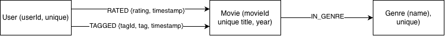
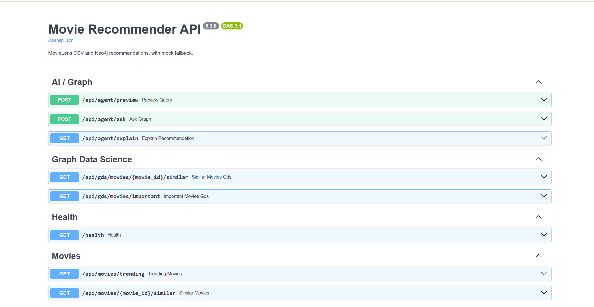

# movie-recommender-graphdb
Graph-based movie recommendation system using Neo4j, FastAPI, Graph Data Science and AI.
## Project Overview

Movie Recommender GraphDB is an end-to-end movie recommendation application built with Neo4j, Python, FastAPI, Graph Data Science (GDS), and a local AI assistant.

The application uses graph relationships between users, movies, and genres to generate recommendations, identify important movies, and answer natural-language questions.

### Main Features

- Personalized movie recommendations based on user rating relationships.
- Similar movie recommendations using collaborative signals.
- Movie importance ranking with GDS PageRank.
- Movie similarity analysis with GDS Node Similarity.
- Natural-language movie queries through Ollama and validated Cypher templates.
- Graph-grounded explanations and safety guardrails.
- Reproducible deployment using Docker Compose.

## Dataset and Graph Schema

The project uses the **MovieLens Small** dataset provided by GroupLens.

Dataset source: https://grouplens.org/datasets/movielens/latest/

The imported graph contains:

| Element | Count |
|---|---:|
| Movies | 9,742 |
| Users | 610 |
| Genres | 19 |
| RATED relationships | 100,836 |
| IN_GENRE relationships | 22,050 |
| TAGGED relationships | 3,683 |

### Graph Schema



The database uses three main node labels: `Movie`, `User`, and `Genre`.

The relationships `RATED`, `TAGGED`, and `IN_GENRE` capture user interactions and movie classification.

For the full modeling rationale, see [Graph Modeling Documentation](docs/GRAPH_MODEL_JULIETTE.md).

## API Features and Examples

The application exposes a REST API through FastAPI.

| Endpoint | Description |
|---|---|
| `GET /health` | Check application health |
| `GET /api/movies/trending` | Retrieve popular movies |
| `GET /api/movies/1/similar` | Find movies similar to Toy Story |
| `GET /api/users/1/recommendations` | Generate personalized recommendations |
| `GET /api/users/1/discover` | Discover less-popular recommendations |
| `GET /api/gds/movies/1/similar` | Compute movie similarity using GDS |
| `GET /api/gds/movies/important` | Rank movies using PageRank |
| `POST /api/agent/ask` | Answer natural-language movie questions |
| `GET /api/agent/explain` | Explain recommendations using graph evidence |

Example requests after starting Docker Compose:

```bash
curl http://localhost:8080/health
curl http://localhost:8080/api/movies/trending
curl http://localhost:8080/api/gds/movies/important
```

Interactive API documentation: http://localhost:8080/docs

### Swagger API Screenshot



## AI Assistant and Safety

The AI assistant uses Ollama to interpret natural-language questions.

Instead of allowing the language model to execute arbitrary Cypher, the system restricts it to predefined, read-only query templates.

Pydantic validation, parameterized queries, and request limits protect the database from invalid or unsafe instructions.

The assistant can retrieve movies by genre, find similar movies, identify user favorites, and retrieve popular movies.

See [AI Assistant Documentation](docs/README_APOLLINE.md) for implementation details.

## Graph Algorithms and Performance

The project implements two Neo4j Graph Data Science algorithms:

- **Node Similarity:** compares movies using relationships to users who rated them.
- **PageRank:** ranks structurally important movies in the rating graph.

These complement the Python recommendation workflow.

The team also benchmarks Cypher queries using `EXPLAIN`, `PROFILE`, database hits, and repeated execution times.

See [Algorithm Documentation](docs/README_ALIX.md) and [Cypher Benchmarks](docs/QUERY_BENCHMARKS_JULIETTE.md).

## Demonstration Notebook

The project includes `demo.ipynb`, a Jupyter notebook demonstrating API connectivity, graph statistics, movie recommendations, GDS algorithms, and AI guardrails.

The AI demonstration requires Ollama with the configured model.

## Team Contributions

| Team Member | Main Responsibilities |
|---|---|
| Tiphaine | Team coordination, FastAPI backend, Neo4j integration, GDS API integration, demonstration notebook |
| Camille | Docker Compose, deployment, Nginx, CI and infrastructure |
| Juliette | Neo4j graph modeling, MovieLens ETL, Cypher optimization and benchmarking |
| Alix | Recommendation algorithms, ML evaluation, GDS Node Similarity and PageRank |
| Apolline | AI assistant, Ollama integration, Cypher validation, guardrails and explanations |

Development follows a Git branch and Pull Request workflow, with peer reviews before merging into `main`.
## Infrastructure, Testing and Deployment

## Overview

This document describes the infrastructure and quality checks
for the Movie Recommender GraphDB project.

## Docker


Build and start the services:

```powershell
docker compose up --build -d
```


Check their status:

```bash
docker compose ps
```

The stack includes the FastAPI application, Neo4j and Nginx.

## Development environment

Install development dependencies:

```bash
make install
```

Run the application locally:

```bash
make run
```

## Quality checks

Run tests with coverage:

```bash
make test
```

Run Pylint:

```bash
make lint
```

The test coverage target is at least 60%, and the Pylint
score target is at least 9.5/10.

Latest validation results:

- Tests: 127 passed.
- Test coverage: 89.60%.
- Pylint score: 10.00/10.

## Continuous Integration

GitHub Actions runs the test and lint commands for relevant
pushes and pull requests.

## Environment variables

Configure local environment variables using `.env.example`.
Never commit the actual `.env` file or expose credentials.

## Docker Quickstart

### Prerequisites

- Docker Desktop installed and running.
- A configured `.env` file based on `.env.example`.
- The MovieLens Small dataset available in `data/ml-latest-small/`.

### Start the application

Build and start the services:

docker compose up --build -d


Check service status:

docker compose ps


### Access the services

- API health check: http://localhost:8080/health
- Swagger documentation: http://localhost:8080/docs
- Neo4j Browser: http://localhost:7474

### Import and verify MovieLens data

docker compose exec api python -m scripts.import_movielens
docker compose exec api python -m scripts.verify_graph


For the complete setup, configuration, Ollama integration, health checks, and troubleshooting instructions, see [Docker Deployment Guide](docs/DOCKER_DEPLOYMENT.md).

## Public Docker Image

The FastAPI application is published as a public Docker image on Docker Hub.

**Docker Hub repository:**  
[Movie Recommender API](https://hub.docker.com/r/cammetz/movie-recommender-api)

### Pull the image

docker pull cammetz/movie-recommender-api:1.0

The image includes the Python API and its dependencies.

Neo4j, Ollama, credentials, and the MovieLens dataset are managed separately. See the [Docker Deployment Guide](docs/DOCKER_DEPLOYMENT.md) for instructions on starting the complete application with Docker Compose.

## System Architecture

Our application uses Nginx as a reverse proxy for FastAPI,
which connects to Neo4j for graph queries and GDS algorithms.
The AI assistant uses Ollama for constrained natural-language
interpretation.

[View the system architecture diagram](docs/SYSTEM_ARCHITECTURE.md)

## Modeling Appendix — AI Baseline Comparison

We generated an independent baseline using ChatGPT from a generic movie-recommendation prompt. Both the generated baseline and our implemented graph use User, Movie and Genre nodes, RATED {rating, timestamp} relationships and Movie-[:IN_GENRE]->Genre.

The main modeling difference concerns free-text tags:
- AI-generated baseline: User-[:TAGGED {timestamp}]->Tag-[:TAG_OF]->Movie, with an additional Tag node.
- Our MovieLens implementation: User-[:TAGGED {tag, timestamp, tagId}]->Movie, representing the user-to-movie tagging interaction directly.
We chose relationship properties for tags because the MovieLens data records who tagged each movie, the text of the tag and when it was submitted. This avoids introducing a Tag node and another traversal that our current queries do not require. The two models also share several sensible choices; the comparison is not presented as if every element were different.

[See the verbatim AI baseline, generation date, model information, and full modeling comparison](docs/MODELING_DECISIONS_AND_AI_BASELINE.md).