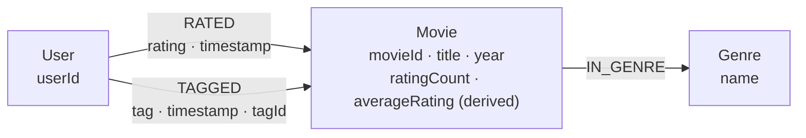

# Graph modeling rationale and AI-generated baseline comparison

## Data and final model

**Dataset:** GroupLens MovieLens Small (`movies.csv`, `ratings.csv`, `tags.csv`). We only model entities and interactions grounded in the dataset.

The implemented model is:



The full-import graph used for validation contains approximately 9,742 Movie nodes, 610 User nodes, 19 Genre nodes and 100,836 `RATED` relationships. Counts should be verified against the running database; they are not hard-coded assumptions about other datasets.

## AI-generated generic baseline (comparison)

**Model used:** ChatGPT -6 & Claude Sonnet 5.5.

**Date of generation:** 2 November 2026.

**Prompt (verbatim):**

> Propose a basic Neo4j graph schema for a movie recommendation application using user ratings, genres and free-text tags. Do not assume any specific CSV schema or constraints.

**AI response (verbatim, plain-text diagram):**

```text
(:User)
   |
   | [:RATED {rating, timestamp}]
   v
(:Movie)
   |
   | [:IN_GENRE]
   v
(:Genre)

(:User)
   |
   | [:TAGGED {timestamp}]
   v
(:Tag)
   |
   | [:TAG_OF]
   v
(:Movie)
```

This is the actual AI-generated baseline, reproduced without altering its nodes, relationships, or properties. It was generated from the generic prompt above, without providing the actual MovieLens CSV structure. It is **not** the schema implemented in Neo4j.

## Why our graph differs

| Design choice | Actual AI-generated baseline | Implemented MovieLens graph | Rationale |
|---|---|---|---|
| Node labels | `User`, `Movie`, `Genre`, `Tag` | `User`, `Movie`, `Genre` | The dataset contains free-text tags submitted by users; a separate `Tag` node is not needed for our current recommendation queries. |
| Tagging event | `User-[:TAGGED {timestamp}]->Tag-[:TAG_OF]->Movie` | `User-[:TAGGED {tag, timestamp, tagId}]->Movie` | The MovieLens CSV supplies userId, movieId, tag and timestamp. The graph also stores a `tagId` on the relationship (not a source column in the standard MovieLens Small tags.csv). Modeling the tagging interaction directly preserves attribution without introducing an extra node or traversal. |
| Genre membership | `Movie-[:IN_GENRE]->Genre` | `Movie-[:IN_GENRE]->Genre` | This is a **similarity**, not a difference: both use reusable Genre nodes. Our implementation also has unique-identity constraints for genres. |
| Rating interaction | `User-[:RATED {rating, timestamp}]->Movie` | `User-[:RATED {rating, timestamp}]->Movie` | Another **similarity**: rating value and time correctly belong to the interaction. Our ETL additionally uses stable source IDs and constraints. |
| Identity and indexes | Not specified in the baseline diagram | Unique keys/constraints for `Movie.movieId`, `User.userId`, and `Genre.name` | These make imports idempotent and support efficient indexed lookups. We should not claim the generic baseline explicitly rejected indexes; it simply did not specify them. |
| Derived movie statistics | Not specified in the baseline diagram | `Movie.ratingCount` and `Movie.averageRating` (derived from ratings) | These are derived from `RATED`, not new source facts. The optimization caches them for faster Trending queries, with a fallback for older imports. They must be refreshed when ratings change. |

The key design difference is the handling of tags. The AI baseline chooses an independent `Tag` node plus `TAG_OF`; our graph represents tagging directly as a **user–movie relationship** with properties. Both choices can be valid, but the latter more closely matches the supplied MovieLens interaction records and our query requirements. We retain and openly acknowledge the similarities in the two models.

## Why Neo4j fits the recommendation problem

- **Collaborative recommendation:** a traversal such as `User → RATED → Movie ← RATED ← User → RATED → Movie` discovers users with shared viewing/rating history, then candidate movies.
- **Genre-based explanation:** `Movie → IN_GENRE → Genre ← IN_GENRE ← Movie` gives a concrete shared-genre explanation. Shared genre alone does **not** explain a collaborative GDS Node Similarity score.
- **GDS:** Node Similarity uses relationships induced by shared raters, while PageRank estimates structural importance on a projected User–Movie graph; these algorithms measure different things.
- **Constraints and query plans:** unique IDs support index seeks. Expensive many-hop traversals still require analysis with Neo4j `PROFILE` and `EXPLAIN` (see Juliette's benchmark report).

## Trade-offs and limits

1. The graph includes only provided MovieLens entities. Richer metadata (cast, directors, descriptions) would require another documented source and a schema migration.
2. Tags are kept as relationship properties; this preserves attribution but is less convenient for global tag-to-tag analysis. A future normalized Tag node is possible if that use case is justified.
3. Cached counts and averages are a deliberate denormalization for the static MovieLens dataset. If the API supports adding ratings later, the values must be updated consistently.
4. Node Similarity and PageRank are not the same as semantic/content similarity. A recommendation explanation must identify which evidence it actually uses.
5. Reproducibility requires documenting import steps, schema constraints, indexes and the rationale above rather than accepting a generic generated diagram as the final design.

## Supporting evidence

- Schema diagram: `docs/graph_schema.png` and `docs/graph_schema.mmd`.
- Schema and import choices: `docs/GRAPH_MODEL_JULIETTE.md`.
- Cypher and query plans: `docs/graph_queries.cypher`, `docs/QUERY_BENCHMARKS_JULIETTE.md`.
- GDS queries and methods: `docs/gds_queries.cypher`, `docs/README_ALIX.md`.
