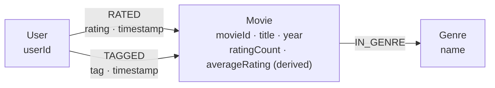
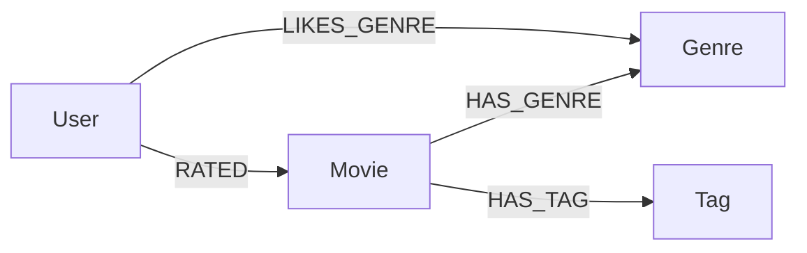

# Graph modeling rationale and AI-generated baseline comparison

## Data and final model

**Dataset:** GroupLens MovieLens Small (`movies.csv`, `ratings.csv`, `tags.csv`). We only model entities and interactions grounded in the dataset.

The implemented model is:

The full-import graph used for validation contains approximately 9,742 Movie nodes, 610 User nodes, 19 Genre nodes and 100,836 `RATED` relationships. Counts should be verified against the running database; they are not hard-coded assumptions about other datasets.

## AI-generated generic baseline (comparison)

**Prompt used to produce this illustrative baseline:**

> Propose a basic Neo4j graph schema for a movie recommendation application using user ratings, genres and free-text tags. Do not assume any specific CSV schema or constraints.

A generic model from that short prompt could reasonably look like this:

This baseline is intentionally **illustrative and AI-generated for comparison**; it is not an additional schema deployed in Neo4j or a claim that every AI model produces the same structure. It does not incorporate the actual MovieLens CSV semantics.

## Why our graph differs

| Design choice | Generic baseline | Implemented MovieLens graph | Reason |
|---|---|---|---|
| Genre preferences | `User-[:LIKES_GENRE]->Genre` | Not stored as a direct fact | MovieLens Small has ratings, not explicit declarations that a user likes a genre. Preferences can be inferred without inventing data. |
| Genre membership | `Movie-[:HAS_GENRE]->Genre` | `Movie-[:IN_GENRE]->Genre` | Genres are reusable nodes so queries can traverse from a Movie through a Genre to other Movies. The chosen relation name describes membership. |
| Free-text tags | `Movie-[:HAS_TAG]->Tag` with Tag as a separate node | `User-[:TAGGED {tag, timestamp}]->Movie` | The source is a *user tagging event* with actor, target and timestamp. Modeling only a movie-to-tag edge would lose who supplied it. |
| Rating | `User-[:RATED]->Movie` with unspecified properties | `RATED` stores rating and timestamp | The strength and time of feedback belong to the user–movie interaction, not the User or Movie alone. |
| Unique identity | Unspecified | `User.userId`, `Movie.movieId`, `Genre.name` constraints/indexes | Stable source identifiers support idempotent ETL and indexed lookup. |
| Extra actors, directors or social edges | May be imagined in generic recommenders | Not modeled | The supplied MovieLens Small CSVs do not provide cast or friendship data. Missing data must not be invented. |
| Average rating | Could be computed each time or treated as a primary movie attribute | Derived `ratingCount` and `averageRating` cached on Movie, backed by `RATED` | The cache accelerates Trending queries; it is not the source of truth and must be refreshed when ratings change. |

## Why Neo4j fits the recommendation problem

- **Collaborative recommendation:** a traversal such as `User → RATED → Movie ← RATED ← User → RATED → Movie` discovers users with shared viewing/rating history, then candidate movies.
- **Genre-based explanation:** `Movie → IN_GENRE → Genre ← IN_GENRE ← Movie` gives a concrete shared-genre explanation. Shared genre alone does **not** explain a collaborative GDS Node Similarity score.
- **GDS:** Node Similarity uses relationships induced by shared raters, while PageRank estimates structural importance on a projected User–Movie graph; these algorithms measure different things.
- **Constraints and query plans:** unique IDs support index seeks. Expensive many-hop traversals still require analysis with Neo4j `PROFILE` and `EXPLAIN` (see Juliette's benchmark report).

## Trade-offs and limits

1. The graph includes only provided MovieLens entities. Richer metadata (cast, directors, descriptions) would require another documented source and a schema migration.
2. Tags are kept as relationship properties; this preserves attribution but is less convenient for global tag-to-tag analysis. A future normalized Tag node is possible if that use case is justified.
3. Precomputed counts and averages are a deliberate denormalization for a static dataset. If the API supports adding ratings later, those values must be updated consistently.
4. Node Similarity and PageRank are not the same as semantic/content similarity. A recommendation explanation must identify which evidence it actually uses.
5. Reproducibility requires documenting import steps, schema constraints, indexes and the rationale above rather than accepting a generic generated diagram as the final design.

## Supporting evidence

- Schema diagram: `docs/graph_schema.png` and `docs/graph_schema.mmd`.
- Schema and import choices: `docs/GRAPH_MODEL_JULIETTE.md`.
- Cypher and query plans: `docs/graph_queries.cypher`, `docs/QUERY_BENCHMARKS_JULIETTE.md`.
- GDS queries and methods: `docs/gds_queries.cypher`, `docs/README_ALIX.md`.
