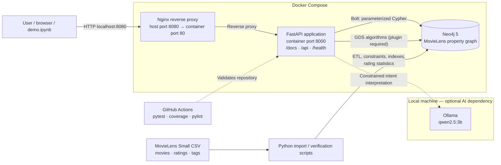

# System architecture — Movie Recommender GraphDB

## Purpose

This diagram describes the end-to-end application, including the three Docker Compose services and the optional local LLM runtime. The API exposes a single HTTP interface for collaborative recommendations, graph algorithms and the AI assistant.

> **GDS deployment note:** The reviewed `docker-compose.yml` does not explicitly install the Neo4j Graph Data Science plugin. The GDS endpoints require a Neo4j instance where GDS is installed and enabled; they must not be presented as guaranteed on a fresh Compose deployment. Check `RETURN gds.version() AS version` in Neo4j Browser. The deployment configuration or setup guide must be updated before claiming fresh-install reproducibility.

> Ollama runs separately from the three Docker Compose services in the tested local development arrangement. It is required for the AI/Graph endpoints, but not for the ordinary movie recommendation or GDS endpoints. Its host/network address must match the local Docker and environment configuration.

## Responsibilities and data flow

1. **Client:** Swagger (`/docs`) and the demonstration notebook call the API through Nginx on `http://localhost:8080`.
2. **Reverse proxy:** Nginx forwards HTTP requests to the FastAPI service on Docker's internal network. FastAPI's port 8000 is not necessarily published directly on the host.
3. **API:** FastAPI validates request parameters with Pydantic, handles database errors, and exposes movie, user, GDS and AI/Graph endpoints.
4. **Neo4j:** Stores the `User`, `Movie` and `Genre` graph and `RATED`, `TAGGED` and `IN_GENRE` relationships. When installed and enabled, the Neo4j Graph Data Science plugin performs Node Similarity and PageRank using in-memory graph projections. This is a required deployment prerequisite, not something guaranteed by the current Compose definition.
5. **ETL:** Python scripts load MovieLens Small, create constraints and indexes, verify imported counts and precompute movie rating statistics for the optimized Trending query.
6. **AI layer:** Ollama interprets a natural-language request; the application restricts execution to validated intentions and predefined Cypher patterns instead of blindly executing arbitrary model-generated Cypher. Graph-derived answers must be distinguishable from model interpretation.
7. **Quality controls:** GitHub Actions tests and lints code; unit tests can run without the live database or Ollama. Integration demonstrations additionally check the deployed stack.

## Endpoint families

| Purpose | Example endpoint | Implementation |
|---|---|---|
| Health | `GET /health` | FastAPI |
| Trending movies | `GET /api/movies/trending` | Neo4j/Cypher; precomputed movie statistics with fallback for older imports |
| Similar movies | `GET /api/movies/{movie_id}/similar` | Cypher on co-rating patterns |
| Personalization | `GET /api/users/{user_id}/recommendations` | Cypher neighbor traversals |
| Discovery | `GET /api/users/{user_id}/discover` | Cypher ranking of less-rated candidates |
| GDS similarity | `GET /api/gds/movies/{movie_id}/similar` | GDS Node Similarity |
| GDS importance | `GET /api/gds/movies/important` | GDS PageRank |
| Natural-language assistant | `POST /api/agent/ask` | Ollama + constrained intent + Neo4j |
| Recommendation explanation | `GET /api/agent/explain` | Explicit graph connections (e.g. common genres) |

## Architectural decisions

- **Nginx in front of FastAPI:** a single host-facing entry point, with internal networking for the API and database.
- **Neo4j instead of relational joins:** ratings and shared neighbors are naturally traversed as graph relationships, while GDS can operate on projections.
- **GDS inside Neo4j:** Node Similarity and PageRank require the GDS plugin to be installed and enabled in Neo4j; they are not a fourth Compose microservice. The reviewed Compose configuration does not currently provision GDS explicitly.
- **Ollama isolated from the database:** the application checks intent and builds a permitted query; the model is not given a direct database write interface.
- **Cached aggregate statistics:** `ratingCount` and `averageRating` on Movie avoid rescanning every rating for each Trending request. The underlying `RATED` edges remain the source of truth; statistics must be refreshed whenever ratings change.
- **Reproducibility:** `.env.example` documents configuration; `.env`, downloaded datasets, passwords and generated secrets must not be committed.

## How to demonstrate

From the repository root, follow the Docker deployment guide, then verify `docker compose ps`, GDS installation using `RETURN gds.version() AS version`, Swagger on `http://localhost:8080/docs`, graph counts, the two GDS endpoints, and at least one successful and one rejected AI request on a machine with Ollama installed. See `demo.ipynb` and `docs/DOCKER_DEPLOYMENT.md`.
